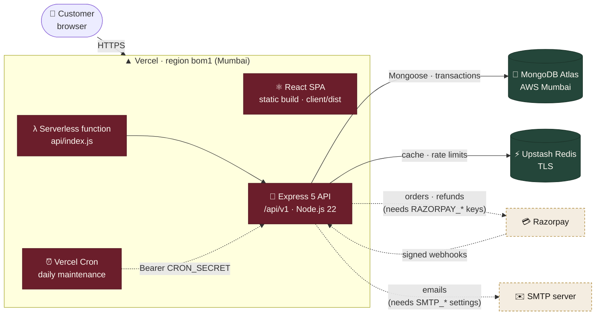
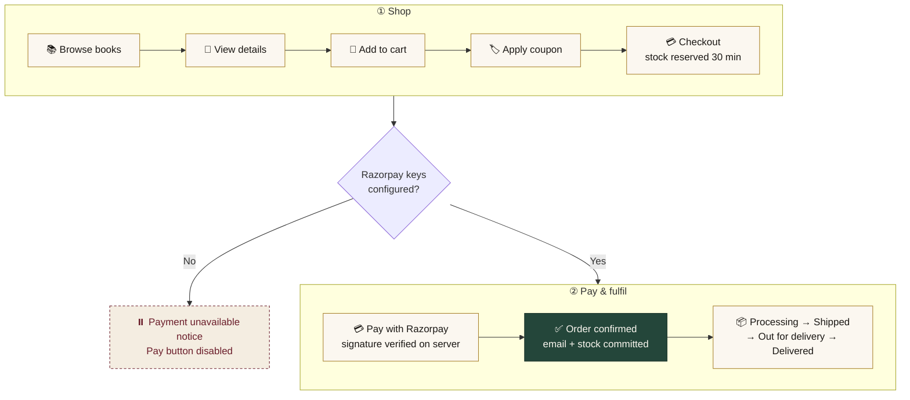

<div align="center">


### 📚 An independent online bookstore, built as a production-grade MERN application

Curated shelves, honest reader reviews, coupons, secure Razorpay checkout, order tracking<br/>and a full admin console — deployed on Vercel with MongoDB Atlas and Upstash Redis.

<br/>

<a href="https://shelfify-store.vercel.app"></a>
<a href="https://github.com/sachinu25/shelfify"></a>


<br/><br/>

<a href="https://shelfify-store.vercel.app">
  
</a>

<sub>Built by <b>Sachin Upadhyay</b></sub>

</div>

<br/>

## 🧭 Contents

<table>
<tr>
<td valign="top">

- [📸 Showcase](#-showcase)
- [✨ Features](#-features)
- [🧰 Technology stack](#-technology-stack)
- [🏛️ Architecture](#️-architecture)

</td>
<td valign="top">

- [🛒 Customer journey](#-customer-journey)
- [🗂️ Project structure](#️-project-structure)
- [🚀 Getting started](#-getting-started)
- [🔌 API reference](#-api-reference)

</td>
<td valign="top">

- [☁️ Production deployment](#️-production-deployment)
- [🧪 Testing](#-testing)
- [🔐 Security](#-security)
- [👨‍💻 Developer](#-developer)

</td>
</tr>
</table>

<br/>

## 📸 Showcase

<table>
<tr>
<td width="50%" valign="top">

<p align="center"><b>📖 Book listing</b><br/><sub>Genre, price and rating filters, sorting and pagination</sub></p>
</td>
<td width="50%" valign="top">

<p align="center"><b>🔎 Book details</b><br/><sub>Pricing, stock status, reviews and recommendations</sub></p>
</td>
</tr>
<tr>
<td width="50%" valign="top">

<p align="center"><b>🛍️ Shopping bag</b><br/><sub>Server-priced totals with a coupon applied</sub></p>
</td>
<td width="50%" valign="top">

<p align="center"><b>❤️ Wishlist</b><br/><sub>Saved books, one click to move into the bag</sub></p>
</td>
</tr>
<tr>
<td colspan="2" valign="top">

<p align="center"><b>📊 Admin dashboard</b><br/><sub>Revenue, orders, top sellers, revenue by genre and low-stock alerts</sub></p>
</td>
</tr>
</table>

<div align="center">

<p><b>📱 Fully responsive</b> <sub>— the same storefront on a 390 px phone screen</sub></p>
</div>

> [!NOTE]
> Screenshots are real captures of this codebase running locally with the seed catalog. The admin dashboard is shown with **sample orders** in a throwaway local database, and account emails are masked.

<br/>

## ✨ Features

### 🛍️ For readers

<table>
<tr>
<td width="33%" valign="top">

#### 🔐 Accounts
Register and sign in, forgot and reset password by email, change password, and an address book with a default address. Sessions stay signed in across tabs.

</td>
<td width="33%" valign="top">

#### 🔎 Discover
Full-text search with live suggestions. Filter by genre, price, rating, availability and fast delivery, with seven sort orders and shareable URL-based filters.

</td>
<td width="33%" valign="top">

#### 📖 Book pages
Ratings and reviews, with a **verified purchase** badge, plus related books, "frequently bought together" and personalised recommendations.

</td>
</tr>
<tr>
<td width="33%" valign="top">

#### 🛒 Cart
Works for guests and is merged into the account on sign-in. Totals are always priced by the server. Quantities, save for later and free delivery above ₹499.

</td>
<td width="33%" valign="top">

#### ❤️ Wishlist
Save books for later and move them to the bag in one click. Counters in the navigation stay in sync.

</td>
<td width="33%" valign="top">

#### 🏷️ Coupons
Percentage or flat discounts with a minimum order value, maximum discount, validity window, and global and per-customer limits. Available offers appear in the bag.

</td>
</tr>
<tr>
<td width="33%" valign="top">

#### 💳 Checkout
Totals are computed on the server and stock is reserved for 30 minutes. Payment goes through Razorpay with signature verification (requires Razorpay keys).

</td>
<td width="33%" valign="top">

#### 📦 Orders
Order history, a status timeline from payment to delivery, tracking details, and cancellation before dispatch with an automatic refund.

</td>
<td width="33%" valign="top">

#### ✉️ Email
Welcome, password reset, order confirmation and shipping updates. Sent through SMTP when configured, otherwise logged.

</td>
</tr>
</table>

### 🧑‍💼 For store admins

<table>
<tr>
<td width="33%" valign="top">

#### 📊 Dashboard
Revenue, paid orders, average order value and customers over 7 days, 30 days, 90 days or a year, compared with the previous period. Daily charts, top sellers, revenue by genre and low-stock alerts.

</td>
<td width="33%" valign="top">

#### 📚 Catalog
Create, edit, hide and delete books: pricing and MRP, genre, badges, cover image and description.

</td>
<td width="33%" valign="top">

#### 🏬 Inventory
Set or adjust stock, give each book its own low-stock threshold, filter to low-stock books, and see total stock value.

</td>
</tr>
<tr>
<td width="33%" valign="top">

#### 🚚 Order management
Filter orders and move them through an enforced status workflow (paid → processing → shipped → out for delivery → delivered), adding carrier and tracking number.

</td>
<td width="33%" valign="top">

#### 🎟️ Coupon management
Create, edit, deactivate and delete coupons, with usage counts.

</td>
<td width="33%" valign="top">

#### 👥 Customers
Search customers, change roles or block accounts. Every change signs the affected account out immediately.

</td>
</tr>
</table>

<br/>

## 🧰 Technology stack

<table>
<tr>
<td><b>🎨 Frontend</b></td>
<td>


</td>
</tr>
<tr>
<td><b>⚙️ Backend</b></td>
<td>


</td>
</tr>
<tr>
<td><b>🗄️ Data</b></td>
<td>


</td>
</tr>
<tr>
<td><b>💳 Payments</b></td>
<td>

</td>
</tr>
<tr>
<td><b>☁️ Hosting</b></td>
<td>

</td>
</tr>
<tr>
<td><b>🧪 Testing</b></td>
<td>


</td>
</tr>
</table>

<br/>

## 🏛️ Architecture

One Vercel project serves both the storefront and the API from **the same origin**. That lets the refresh token be an `HttpOnly` cookie without exposing the API to cross-site requests.



<sub>Solid lines are always active. Dashed integrations turn on only when their environment variables are set.</sub>

<br/>

## 🛒 Customer journey



At checkout the server re-prices the bag, re-checks the coupon and **reserves stock for 30 minutes**. Unpaid reservations are released automatically, and a repeated checkout request is safely deduplicated with an idempotency key.

> [!IMPORTANT]
> Online payment needs Razorpay keys (`RAZORPAY_KEY_ID`, `RAZORPAY_KEY_SECRET`, `RAZORPAY_WEBHOOK_SECRET`). Without them, as on the current live demo, you can browse, fill the cart, apply coupons and reach checkout, and the Pay button stays disabled with a clear notice.

<br/>

## 🗂️ Project structure

```text
shelfify/
├── api/
│   └── index.js              # Vercel serverless entry: wraps the Express app
├── client/                   # React 19 + Vite storefront and admin console
│   ├── public/covers/        # Book cover images
│   ├── src/
│   │   ├── components/       # layout/ · product/ · ui/ building blocks
│   │   ├── context/          # Auth, cart, wishlist and toast providers
│   │   ├── hooks/            # Shared React hooks
│   │   ├── lib/              # API client, Razorpay loader, formatting, site info
│   │   ├── pages/            # Storefront pages + admin/ console
│   │   └── styles/           # Tailwind CSS 4 theme tokens
│   └── legacy-cra/           # Original Create React App frontend (preserved)
├── server/                   # Express 5 REST API
│   ├── src/
│   │   ├── config/           # Validated env, MongoDB, Redis, logger
│   │   ├── lib/              # Tokens, pricing, cache, transactions, email, Razorpay
│   │   ├── middleware/       # Auth/RBAC, validation, sanitising, rate limits, errors
│   │   ├── models/           # User, Product, Order, Coupon, Review, RefreshToken, WebhookEvent
│   │   ├── modules/          # admin · auth · cart · coupons · orders · payments
│   │   │                     # products · reviews · users · wishlist
│   │   ├── routes/v1.js      # /api/v1 router
│   │   ├── app.js            # Express app (security, parsing, routes)
│   │   └── server.js         # Long-running Node entry
│   ├── scripts/              # Seeding, local database, production setup checks
│   └── tests/                # Vitest + Supertest suites
├── scripts/                  # Dev runner (API + web) and Vercel env sync
├── docs/screenshots/         # README images
├── vercel.json               # Build, functions, rewrites, headers, cron, region
└── package.json              # Root scripts (Node.js 22.x)
```

<br/>

## 🚀 Getting started

### Prerequisites

- **Node.js 22.x** (the version used in production; the API itself needs at least 20.19)
- **Git**
- Optional: a MongoDB Atlas connection string. Without one, a local MongoDB is started for you.

### 1 · Clone the repository

```bash
git clone https://github.com/sachinu25/shelfify.git
cd shelfify
```

### 2 · Install dependencies

```bash
npm run install:all        # installs server/ and client/
```

### 3 · Configure the environment

```bash
cp server/.env.example server/.env      # Windows (cmd): copy server\.env.example server\.env
```

For local development, every value is optional. Set `SEED_ADMIN_EMAIL` and `SEED_ADMIN_PASSWORD` in `server/.env` to get an admin account. The client works without its own `.env`; see `client/.env.example` for the single optional setting.

### 4 · Run the app

```bash
npm run dev                # API on http://localhost:5000 + storefront on http://localhost:5173
```

When `MONGODB_URI` is empty, `npm run dev` starts a **persistent local MongoDB**, storing data in `server/.data/` (git-ignored). It then seeds the catalog, the coupons `WELCOME10` and `BOOKS200`, and the admin account. Press <kbd>Ctrl</kbd> + <kbd>C</kbd> to stop everything.

<details>
<summary><b>Run the backend and frontend separately</b></summary>

<br/>

```bash
# Backend: persistent local MongoDB (or MONGODB_URI) + API with auto-restart on :5000
npm run dev:local --prefix server

# Frontend: Vite dev server on :5173, proxying /api to localhost:5000
npm run dev:web
```

| Command | What it does |
|---|---|
| `npm run dev:api` | API only, using `MONGODB_URI` from `server/.env` |
| `npm run dev:api:memory` | API with a throwaway in-memory database |
| `npm run db:check` | Verifies `MONGODB_URI` connectivity and permissions |
| `npm run seed` | Seeds the catalog, coupons and admin (idempotent) |
| `npm run build` | Production build of the client |
| `npm test` | Runs the backend test suites |

</details>

<details>
<summary><b>Environment variables</b> (<code>server/.env.example</code>)</summary>

<br/>

Real values belong only in `server/.env` locally, or in Vercel → Project → Settings → Environment Variables. Both are kept out of git.

| Variable | Required | Purpose |
|---|:---:|---|
| `MONGODB_URI` | Production | MongoDB connection string (Atlas in production) |
| `JWT_ACCESS_SECRET` | Production | Signing secret for access tokens, at least 32 random characters. Placeholders are rejected |
| `CLIENT_URL` | Production | Public storefront URL (must be `https://` in production) |
| `CRON_SECRET` | Recommended | Authorises Vercel Cron and unlocks detailed `/api/health` output |
| `REDIS_URL` | Recommended | `rediss://` URL for shared cache and rate limits (Upstash) |
| `RAZORPAY_KEY_ID` · `RAZORPAY_KEY_SECRET` | For payments | Enables online checkout (both must be set together) |
| `RAZORPAY_WEBHOOK_SECRET` | For payments | Verifies Razorpay webhooks |
| `SMTP_HOST` · `SMTP_PORT` · `SMTP_USER` · `SMTP_PASS` · `EMAIL_FROM` | Optional | Sends email; otherwise emails are logged only |
| `NODEJS_HELPERS` | Vercel | Set to `0` so webhooks are verified against the untouched raw body |
| `JWT_ACCESS_TTL` · `REFRESH_TOKEN_TTL_DAYS` · `REFRESH_REUSE_GRACE_SECONDS` | Optional | Session lifetimes (defaults: 15m, 30 days, 30 s) |
| `CORS_ORIGINS` · `COOKIE_SAMESITE` | Optional | Only for split-domain deployments |
| `FREE_SHIPPING_THRESHOLD` · `SHIPPING_FEE` · `ORDER_RESERVATION_MINUTES` | Optional | Business rules (defaults: ₹499, ₹50, 30 minutes) |
| `SEED_ADMIN_EMAIL` · `SEED_ADMIN_PASSWORD` · `SEED_ADMIN_NAME` | Seeding | Admin account created by the seed script |
| `NODE_ENV` · `PORT` · `LOG_LEVEL` | Optional | Runtime mode, port (5000) and log verbosity |

`client/.env.example` has one optional variable, `VITE_API_URL`, which you only need if the API is hosted on a different domain.

In production the API **refuses to start** if a required value is missing or weak.

</details>

<br/>

## 🔌 API reference

Base path **`/api/v1`**. Every response uses one envelope: `{ success, data }` or `{ success, error: { code, message }, requestId }`.

<details>
<summary><b>View all route groups</b></summary>

<br/>

| Group | Endpoints | Access |
|---|---|---|
| **Health** | `GET /api/health` | Public (minimal; detailed with `CRON_SECRET`) |
| **Auth** `/auth` | `POST /register` · `/login` · `/refresh` · `/logout` · `/forgot-password` · `/reset-password` · `/change-password` · `GET /me` | Public, plus signed-in for `/me` and `/change-password` |
| **Products** `/products` | `GET /` · `/collections` · `/facets` · `/suggest` · `/recommendations` · `/:idOrSlug` · `/:idOrSlug/related` · `/:idOrSlug/also-bought` | Public (recommendations are personalised when signed in) |
| **Reviews** `/products/:idOrSlug/reviews` | `GET /` · `GET /me` · `POST /` · `DELETE /:reviewId` | Public read, signed-in write |
| **Cart** `/cart` | `POST /quote` (guest pricing) · `GET /` · `POST /items` · `PATCH /items/:productId` · `DELETE /items/:productId` · `DELETE /` · `POST /merge` | Signed-in (quote is public) |
| **Wishlist** `/wishlist` | `GET /` · `POST /:productId` · `DELETE /:productId` | Signed-in |
| **Orders** `/orders` | `POST /checkout` · `GET /` · `GET /:id` · `POST /:id/pay` · `POST /:id/verify` · `POST /:id/cancel` | Signed-in, own orders only |
| **Payments** `/payments` | `GET /config` · `POST /webhook` | Public; webhook needs a Razorpay signature |
| **Users** `/users` | `PATCH /me` · `GET` / `POST /me/addresses` · `PATCH` / `DELETE /me/addresses/:addressId` | Signed-in |
| **Coupons** `/coupons` | `GET /available` | Public |
| **Admin** `/admin` | `GET /analytics` · `GET` / `POST /products` · `GET` / `PATCH` / `DELETE /products/:id` · `PATCH /products/:id/stock` · `GET /orders` · `PATCH /orders/:id/status` · `POST /orders/release-expired` · `POST /maintenance` · `GET` / `POST /coupons` · `PATCH` / `DELETE /coupons/:id` · `GET /users` · `PATCH /users/:id` | Admin role |
| **Internal** `/internal/cron` | `GET /release-reservations` · `GET /maintenance` | `CRON_SECRET` bearer |

</details>

<br/>

## ☁️ Production deployment

<table>
<tr>
<td align="center" width="20%"><br/><sub><b>Hosting</b><br/>Static SPA + serverless API + daily cron</sub></td>
<td align="center" width="20%"><br/><sub><b>Database</b><br/>Replica set with multi-document transactions</sub></td>
<td align="center" width="20%"><br/><sub><b>Cache</b><br/>Shared rate limits and cache invalidation over TLS</sub></td>
<td align="center" width="20%"><br/><sub><b>Runtime</b><br/>Pinned in <code>package.json</code> engines</sub></td>
<td align="center" width="20%"><br/><sub><b>Region</b><br/>Functions next to the AWS Mumbai database</sub></td>
</tr>
</table>

**Live:** https://shelfify-store.vercel.app

- `vercel.json` defines the install and build, the `/api` function, SPA rewrites, immutable asset caching, the security headers and the daily maintenance cron.
- The cron releases expired stock reservations and retries any interrupted fulfilment, emails or refunds.
- Production configuration is validated at startup and fails closed.
- Indexes are built by the seed script, not during cold starts.
- **Current live configuration:** Razorpay and SMTP are not configured yet, so online payment is disabled and emails are logged rather than sent.

<details>
<summary><b>Deploy your own</b></summary>

<br/>

1. Create a **MongoDB Atlas** cluster in AWS Mumbai (`ap-south-1`) and allow network access from Vercel.
2. Create an **Upstash Redis** database in `ap-south-1` and copy its `rediss://` TCP URL.
3. Import the repository into **Vercel** with this folder as the root directory. `vercel.json` handles everything else.
4. Add the production environment variables listed above (`MONGODB_URI`, `JWT_ACCESS_SECRET`, `CLIENT_URL`, `CRON_SECRET`, `REDIS_URL`, `NODEJS_HELPERS=0`), plus `RAZORPAY_*` and `SMTP_*` if you want payments and email.
5. Seed once from your machine: `MONGODB_URI=… SEED_ADMIN_EMAIL=… SEED_ADMIN_PASSWORD=… npm run seed`.
6. For payments, add the Razorpay webhook `https://<your-domain>/api/v1/payments/webhook` with the events `payment.captured`, `order.paid`, `payment.failed`, `refund.processed` and `refund.failed`.

</details>

<br/>

## 🧪 Testing

<div align="center">


<sub>These are the latest reported verification results.</sub>

</div>

| Suite | Tests | What it proves |
|---|:---:|---|
| `api.test.js` | 18 | Auth and RBAC, injection stripping, catalog, cart and coupons, guest-cart merge, checkout idempotency, oversell prevention, forged payment signatures, webhooks, cancellation and refunds, order privacy, reviews |
| `orders-reliability.test.js` | 15 | Real transactions: concurrent checkout without overselling, crash rollback, coupon limits under concurrency, exactly-once fulfilment, email and refund retries |
| `auth-sessions.test.js` | 11 | Multi-tab refresh grace window, token-theft detection, logout and password revocation, per-account login throttling |
| `security.test.js` | 17 | Fail-closed production config, safe partial updates, http(s)-only URLs, webhook raw body, health exposure, request IDs, cache headers |
| `redis.test.js` | 6 | An unreachable Redis can't crash or stall the API; rate limits and cache invalidation are shared across instances |
| **Browser E2E** | 50 | Full storefront, checkout and admin flows plus mobile layouts, run in Chrome against a local build. This suite is kept outside this repository |

```bash
npm test          # backend suites: Vitest + Supertest + in-memory MongoDB / replica set
```

<br/>

## 🔐 Security

<table>
<tr>
<td width="50%" valign="top">

**🔑 Authentication**
- 15-minute JWT access token, held in memory only
- Rotating refresh tokens in an `HttpOnly`, `Secure`, `SameSite` cookie, stored hashed (SHA-256)
- Reuse detection revokes the whole session family
- Password change, role change or block revokes sessions instantly
- bcrypt password hashing (cost 12)

**🛡️ Authorisation and input**
- Role-based access control for admin routes, plus ownership checks on orders and reviews
- Zod validation of every body, query and parameter
- NoSQL operator stripping, a 100 kb body limit and http(s)-only URLs

</td>
<td width="50%" valign="top">

**💳 Payments**
- Totals always computed on the server
- Timing-safe HMAC verification of Razorpay signatures
- Signed, de-duplicated webhooks verified over the raw body
- Idempotent checkout and atomic stock reservation

**🌐 Platform**
- Helmet, plus CSP, HSTS, `X-Frame-Options` and `Permissions-Policy` headers
- Redis-backed rate limits (global, auth, per-account login, payments)
- Fail-closed production configuration
- Structured logs with secrets redacted and request IDs
- No secrets in the repository; real values live only in env files and Vercel

</td>
</tr>
</table>

<br/>

## 👨‍💻 Developer

<div align="center">

<a href="https://github.com/sachinu25"></a>

### Sachin Upadhyay

**Creator & Developer of Shelfify**

<a href="https://github.com/sachinu25"></a>
<a href="https://shelfify-store.vercel.app"></a>

</div>

<br/>

<details>
<summary><b>Acknowledgements</b></summary>

<br/>

Shelfify grew out of an earlier open-source Create React App bookstore by [Anumodit Shukla](https://github.com/anumodit740). That original frontend is preserved in [`client/legacy-cra/`](client/legacy-cra/), along with its [original README](client/legacy-cra/README.original.md).

</details>

<br/>

<div align="center">

**📚 Shelfify — Your Next Chapter Starts Here.**

<sub>Designed &amp; Developed with ❤️ by <b>Sachin Upadhyay</b></sub>


</div>
